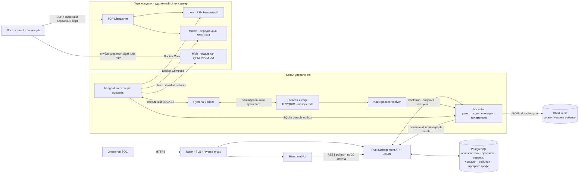
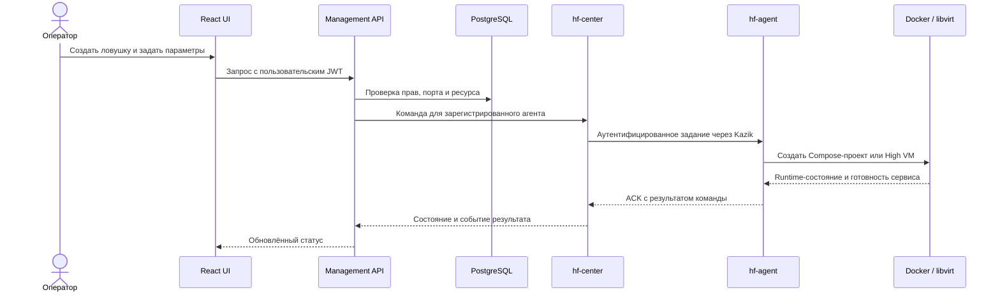
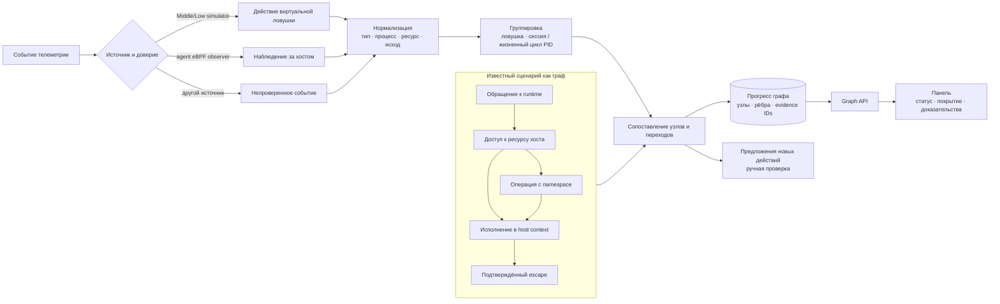

[](https://www.rust-lang.org/)
[](https://clickhouse.com/)
[](https://react.dev/)
[](https://www.postgresql.org/)
[](https://www.docker.com/)

# HoneyForge

### Конструктор и центр управления реалистичными ловушками-приманками

**Описание кейса · III Межрегиональный хакатон · UMIRHACK**

HoneyForge помогает оператору SOC создавать профили ловушек, разворачивать их на удалённых серверах и разбирать действия посетителей в единой панели. Платформа собирает события с парка ловушек, сохраняет подтверждающие данные и сопоставляет последовательности действий с графом известных сценариев.

Ключевой принцип проекта: **ловушка должна быть отдельна от управляющего контура**. Посетитель работает с приманкой; команды управления и телеметрия идут отдельным каналом.

> В репозитории проект также называется **MellCore** — это имя рабочей панели и репозитория. HoneyForge — название платформы и семейства компонентов.

## Центральная идея

Большинство систем наблюдения видят поток сетевых сигналов, но не дают оператору безопасную среду, в которой можно изучать поведение нарушителя. HoneyForge разворачивает приманки с разной глубиной взаимодействия, собирает события их жизненного цикла и показывает, какие шаги известного сценария подтверждаются этими событиями.

Ключевой компромисс — **правдоподобие против радиуса последствий**. Low фиксирует SSH-подключение и попытки входа, но почти не расходует ресурсы. Middle даёт интерактивную виртуальную Linux/Windows-среду и приманочные сервисы, не исполняя команды в ОС хоста. High запускает настоящую ОС, поэтому её изоляция строится на отдельной VM, libvirt-сети и ограниченных правилах публикации.

Платформа различает три вида работы:

1. **Операторский контур** — веб-панель и API управляют пользователями, профилями, серверами, ловушками и доступом.
2. **Контур исполнения** — агент на сервере применяет конфигурацию через Docker или libvirt и проверяет результат.
3. **Контур наблюдения** — ловушки и host monitor создают события; агент и Центр передают и сохраняют их для ленты, аналитики и графа.

Посетитель взаимодействует с опубликованным сервисом приманки; управление и телеметрия проходят по отдельному каналу.

## Кейс на одном экране

| | Что делает платформа |
|---|---|
| Настраивает | Профили, ОС, порт, SSH-авторизацию, уязвимости и файлы-приманки |
| Разворачивает | Low и Middle в Docker; High в изолированной VM через QEMU/KVM |
| Собирает | SSH-сессии, команды виртуальной оболочки, обращения к приманкам и события безопасности хоста |
| Анализирует | Связывает события в сессии и сравнивает их с графом шагов известных сценариев |

Для базового зачёта кейса обязательны рабочие **Low и Middle**. HoneyForge также реализует **High** как дополнительный уровень с полноценной гостевой ОС.

## Киллер-фичи

- **Три уровня интерактивности.** От лёгкой SSH-приманки до полноценной виртуальной машины с отдельным диском и сетевой изоляцией.
- **Выбор сценария входа.** Low может отклонять все входы, принимать одну заданную пару, принимать любой пароль или работать без пароля. Middle и High поддерживают настраиваемую имитацию SSH-аутентификации.
- **Приманки и уязвимые профили.** Виртуальные файлы и сервисные сценарии помогают наблюдать, что именно ищет и открывает посетитель.
- **Граф действий с доказательствами.** Панель показывает совпавшие узлы сценария, исходы и исходные события. Процент — это покрытие узлов графа, а не вероятность взлома.
- **Защита по нескольким слоям.** Контейнерные ограничения, отдельная сеть High VM, наблюдение агента за процессами и опциональная аварийная реакция.
- **Общий SSH-порт.** Dispatcher маршрутизирует подключения между совместимыми Low/Middle ловушками по заданным весам.
- **Два независимых способа использования.** Полная платформа управляет парком и аналитикой; локальный `hf` CLI разворачивает ловушки без Центра и агента.

## Архитектура

Платформа разделена на три контура: **Центр управления**, **канал управления** и **парк ловушек**. Публичный веб-интерфейс и открытый порт ловушки не являются управляющим каналом агента.

Frontend раздаёт Nginx, backend, Center и Agent запускаются как системные службы, а Docker Compose используется для Low/Middle.



### Что происходит при работе

1. Оператор создаёт профиль и регистрирует сервер в панели.
2. Центр устанавливает `hf-agent` и передаёт ему конфигурацию ловушки.
3. Агент поднимает Low/Middle-контейнер или High VM и проверяет готовность выбранного сервиса.
4. Посетитель подключается только к опубликованному сервису ловушки.
5. Агент собирает события и сохраняет их в локальном outbox. Центр подтверждает приём и записывает события в durable spool.
6. События поступают в ClickHouse для аналитики и в backend/PostgreSQL для поиска, прогресса графа и отображения в панели.

Панель обновляет события и инвентарь опросом API примерно раз в 20 секунд.

### Учётные записи и управление доступом

Пользователь входит по email и паролю. Backend хеширует пароль через Argon2id, выдаёт короткоживущий Bearer JWT и по каждому запросу проверяет активность пользователя и актуальные permissions из PostgreSQL. Для продления используется серверная refresh-сессия в HttpOnly cookie. Выход отзывает текущую сессию и её JWT.

Поддерживаются системные роли Owner, Admin, Analyst, Operator и Viewer, а также пользовательские роли и несколько ролей на одного пользователя. Эффективные permissions складываются из назначенных ролей. Ролевые права не отменяют проверку владения ресурсом: знание UUID чужого сервера или ловушки не даёт к ним доступ. Назначающий не может выдать себе или другому пользователю права выше тех, которыми обладает сам; API защищает последнего активного Owner.

Оператор создаёт профиль как описание запуска, а не как запущенную ловушку. Экземпляр ловушки привязывается к серверу, получает снимок профиля, bindings портов и runtime-статус. Отдельные endpoints показывают состояние bootstrap и команд. Credentials агента выдаются отдельно; секреты паролей не должны передаваться в JSON-поле обычной конфигурации.

Документация API — OpenAPI/Swagger в backend; в production она должна быть выключена или ограничена loopback. Frontend обращается к Management API через Nginx reverse proxy. Центр и ClickHouse не должны открываться в интернет как пользовательские endpoints.

### Канал Центр ↔ агент

Агент устанавливает Hysteria 2 client с локальным SOCKS5 endpoint. Соединение идёт к Hysteria edge по QUIC/TLS; внутри него Kazik передаёт регистрации, задания, результаты и пакеты телеметрии. Агент не публикует отдельный порт управления на гостевую или ловушечную сеть. Центр проверяет credentials агента и привязку agent/server/trap.

Устойчивость доставки обеспечивают очереди на обеих сторонах: агент сначала записывает события в SQLite outbox, Центр сохраняет принятые пакеты в JSONL spool и только потом подтверждает приём. Фоновая доставка отправляет записи из spool в ClickHouse и в backend graph sink. Повтор с теми же event IDs дедуплицируется; при временной недоступности хранилища spool остаётся для повторной отправки.

Hysteria использует TLS и masquerade-настройку для неизвестных QUIC-клиентов.

### Подсистемы

| Подсистема | За что отвечает |
|---|---|
| **React UI** | Формы профилей, серверов и ловушек; лента событий; редакторы уязвимостей и приманок; граф и настройки доступа |
| **Management API** (`backend/`) | Пользователи и RBAC, ресурсы, задания, события и API графа |
| **Center** (`hf-center`) | Реестр агентов, доставка заданий, durable spool телеметрии и передача событий в хранилища |
| **Agent** (`hf-agent`) | Применение заданий на сервере, управление Docker Compose и High VM, сбор телеметрии |
| **Low / Middle** | Приём подключений и создание событий взаимодействия с приманкой |
| **High** | Гостевая ОС с отдельным диском в libvirt/QEMU и изолированной сетью |
| **Dispatcher** | Маршрутизация TCP/SSH-подключений общего порта по заданным весам |
| **Локальный `hf` CLI** | Управление жизненным циклом ловушек на одном Linux-хосте |

В полной платформе API управляет **желаемым состоянием**, Center доставляет команды, а агент применяет их и возвращает результат. Статус «команда поставлена» сам по себе не означает, что контейнер или VM уже готовы: подтверждением служат ответ агента и runtime-проверка сервиса.

### Как проходит команда развёртывания



Путь события отличается от пути команды: ловушка или наблюдатель создаёт событие, агент добавляет его в локальную очередь, Center принимает и устойчиво сохраняет пакет, затем отправляет запись в ClickHouse и отдельную копию в backend для поиска и графового сопоставления. Повторная доставка использует ID событий и дедупликацию; сбой одного хранилища не должен превращать уже подтверждённую запись в потерянную.

#### Где находятся данные

| Хранилище | Что хранит | Для чего используется |
|---|---|---|
| **PostgreSQL** | Учётные записи и роли, профили, серверы и ловушки, задания и статусы, аудит, события для API, нормализованные действия и состояние графа | Управление ресурсами, права, просмотр конкретных событий и объяснимые совпадения сценариев |
| **ClickHouse** | Поток принятых событий телеметрии | Быстрые агрегаты и аналитические выборки по большому объёму событий |
| **SQLite агента** | Локальный outbox и временные пакеты до подтверждения Центра | Повторная отправка при обрыве управляющего канала |
| **JSONL Центра** | Durable spool принятых пакетов и отдельные записи отклонённых данных | Восстановление доставки в sinks и диагностика несовместимых событий |
| **Локальное состояние CLI** | ID ловушки, тип, порт и статус; отдельные метаданные High VM | `hf list`, `hf stop` и `hf remove` без удалённого Центра |

Событие телеметрии v1 содержит ID события и ловушки, время возникновения, тип события, опциональные ID сессии и порядковый номер, адреса и порты, протокол, тип сервиса, payload и metadata. До сохранения backend проверяет схему, время, лимиты пакета, привязку ловушки к серверу и повторяющиеся ID. Секретные значения из payload не следует выводить в debug-логи.

События создаются разными источниками: Low пишет подключения, аутентификацию и виртуальные команды; Middle добавляет действия shell/VFS, сетевых обработчиков и deception-сценариев; Linux High sensor передаёт записи из гостя; агент может добавить отдельные host-monitor события. Backend сохраняет ID источника, тип сервиса и происхождение в metadata.

## Ловушки

| Уровень | Как работает | Что видит оператор |
|---|---|---|
| **Low** | Лёгкая SSH-приманка: баннер и выбранная политика авторизации. Shell и команды хоста не запускаются. | Подключения и попытки входа, источник и порт |
| **Middle** | Интерактивная SSH-ловушка с виртуальной файловой системой и фиксированным набором команд. Это эмуляция, а не установленная внутри контейнера Ubuntu или Windows. | Сессии, команды, обращения к файлам-приманкам и результаты сценариев |
| **High** | Отдельная гостевая ОС в QEMU/KVM. Поддерживаются подготовленные образы и установка из ISO; Linux использует SSH, Windows — RDP. | Состояние VM, гостевые события и данные выбранного мониторинга |

### Low: лёгкая SSH-приманка

Low — самостоятельный Rust/Tokio SSH listener. Он отдаёт настроенный баннер, проходит SSH handshake и обрабатывает аутентификацию. После принятого входа доступна простая виртуальная оболочка; процессы и команды хоста не запускаются. Для каждого экземпляра используется собственный Ed25519 host key, который в управляемом режиме сохраняется между перезапусками.

| Режим | Поведение |
|---|---|
| `capture_credentials` | Записывает попытку входа и отклоняет её |
| `configured` | Принимает только пары логин/пароль, заданные в конфигурации |
| `any_password` | Принимает парольную попытку с любым логином и паролем |
| `passwordless` | Принимает SSH-вход без проверки пароля |

События включают подключения, логины, исход аутентификации и введённые команды. В режиме сбора попыток payload может содержать пароли. Это чувствительная телеметрия: доступ к просмотру событий должен быть ограничен, а реальные пароли нельзя использовать для эксперимента.

### Middle: виртуальная интерактивная среда

Middle (`pritvoryashka`) обслуживает SSH и выбранные TCP-протоколы. Linux-профили имитируют Ubuntu, Debian и Arch; Windows-профиль показывает SSH for Windows и PowerShell-подобную командную среду. Файлы, процессы, службы и реестр представлены виртуальными моделями. Команды `docker`, `psql`, `systemctl`, `apt`, `Get-Process` и `reg query` обращаются к этим моделям.

Реализация объединяет SSH server, виртуальную shell/VFS, обработчики сетевых протоколов, deception-сценарии и телеметрию. Состояние виртуальных файлов и системной модели сохраняется в runtime-каталоге ловушки.

Режим SSH-аутентификации Middle:

- **Realistic** — проверяет заданные учётные данные.
- **Adaptive** — для одного IP сначала отклоняет несколько попыток, затем принимает пару и закрепляет её за этим IP для текущей ловушки. Это механизм интерактивной приманки, а не копия настоящей базы учётных записей.

Сетевые уязвимые профили создают отдельные listeners и события попыток. Текущие профили включают:

| Семейство | Профили / сервисы |
|---|---|
| SSH | Слабые учётные данные, разрешённый root login |
| Redis / Docker API | Неаутентифицированный Redis, открытый Docker API — виртуальные обработчики |
| HTTP | Открытая административная панель, path traversal, command injection — запросы обрабатываются как сценарии |
| SQL | Слабые учётные данные для эмулируемых MySQL/PostgreSQL обработчиков |
| FTP | Анонимный вход, отдельный канал передачи и виртуальные файлы |
| Windows Middle | Autologon credentials, AlwaysInstallElevated, writable service binary, guest share в виртуальном реестре/файловой модели |

Имена уязвимостей описывают поведение приманки. Они не означают запуск настоящего уязвимого Redis, Docker daemon или базы данных на хосте. Настоящий сетевой listener создаётся только для явно включённого обработчика Middle; визуальная запись процесса или порта в VFS не открывает порт ОС.

### Приманки и adaptive deception

Пользовательские приманки привязаны к конфигурации ловушки и имеют ID, тип, имя, виртуальный путь и содержимое. В Middle это могут быть фиктивные аккаунты, конфигурации, `.env`, ключи, дампы, резервные копии, облачные credentials, история команд, виртуальные процессы и файлы-canary. Чтение поддерживаемой приманки создаёт событие `bait.opened`, связанное с её ID. Виртуальный процесс помогает сделать `ps`, `ss`, `systemctl` и связанные команды согласованными между собой.

Adaptive deception моделирует последовательность открытия приманок. Например, исследование журналов может привести к резервной копии, а затем к SSH-конфигурации. Оператор видит глубину и переходы сценария. Это детерминированная логика приманки, а не модель, обученная на сложной математической аналитике поведения.

Виртуальные учётные данные, сервисы и файлы находятся внутри модели Middle. Доступ к объекту-canary создаёт событие в ленте ловушки.

### High: настоящая ОС в изолированной VM

High создаёт отдельный QCOW2 overlay для экземпляра, оставляя проверенный базовый образ неизменным. `cloud-init` или установочный рецепт задаёт hostname, пользователя, shell и пароль, добавляет выбранные приманки и включает сервис. QEMU Guest Agent используется для действий внутри гостя и проверки готовности; развёртывание должно завершиться ошибкой, если агент гостя или SSH/RDP не готовы.

| ОС | Путь развёртывания | Наблюдаемость и особенности |
|---|---|---|
| Ubuntu | Подготовленный официальный cloud image либо серверный ISO | SSH; для поддержанного образа — гостевой sensor через virtio-serial |
| Debian | Проверяемый cloud image или Debian installer ISO | Guest Agent и нужные пакеты устанавливаются в копию диска; использует общий механизм High isolation |
| Arch Linux | Подготовленный Arch cloud image или ISO-установщик | Сеть гостя настраивается для DHCP независимо от имени интерфейса; наличие `auditd` влияет на набор audit-событий |
| Windows Server 2022 | Подготовленный Sysprep QCOW2 или поддержанный ISO-установщик | RDP |

В режиме с KVM сеть гостя работает через libvirt-сегмент с `forward mode=none`. Входящая публикация ограничена выбранным SSH или RDP; правила отдельно блокируют доступ VM к хосту и транзит в LAN/management-сети. Для High из ISO команда использует ISO, уже находящийся на сервере; во время установки ей могут понадобиться пакеты хоста и место под установочный и рабочий диск.

Для поддерживаемых Linux High recipes гостевой sensor читает выбранные записи systemd journal и auditd и передаёт их через приватный virtio-serial канал агенту. Он может сообщать загрузку, SSH-сессии, процессы, изменения файлов и попытки исходящих соединений в пределах возможностей конкретного образа. Входящие из гостя события помечаются как недоверенные guest-reports: root внутри VM может остановить или подменить sensor. У Windows рецепта проверяется RDP, но эквивалентного sensor в текущей реализации нет.

Локальный CLI поддерживает готовые образы по `--os`, существующий QCOW2 через `--image` и установку с локального ISO через `--iso`. На Debian/Ubuntu-хосте CLI проверяет KVM/libvirt/QEMU и устанавливает host-пакеты. Образы Windows создаются из одобренного источника с проверкой хеша. Команды и зависимости описаны в [`crates/hf-cli/README.md`](crates/hf-cli/README.md).

## Как работает граф атак

Граф — это версионируемая база известных техник, узлов действий и направленных переходов между ними в PostgreSQL. Matcher нормализует входящие события в действие, класс процесса и ресурса, результат и домен доверия. После этого он проверяет совпадение с узлами и продвигает только достижимые по рёбрам шаги, сохраняя ссылки на исходные события.



### Как читать результат

- **Candidate / кандидат** — найдено совпадение с начальным действием сценария.
- **Attempt / попытка** — обнаружено несколько связанных шагов сценария.
- **Confirmed / подтверждено** — есть отдельное доверенное подтверждение. Для выхода из контейнера действия виртуального shell сами по себе не являются доказательством доступа к хосту.
- **Покрытие / процент совпадения** — число уникальных узлов сценария, подтверждённых событиями, делённое на общее число узлов техники. Повтор одного действия не увеличивает показатель; он не является вероятностью атаки или оценкой уверенности модели.

Граф связывает шаги сценария в пределах временного окна и хранит ссылки на исходные события. Сессии виртуальной ловушки и наблюдения ядра учитываются раздельно. События наблюдателя связываются с жизненным циклом процесса; неизвестные действия могут поступить на ручную проверку.

Для подтверждения выхода из контейнера требуется независимое доверенное host-событие от агента, например подтверждённое исполнение в host-контексте. События симулятора могут показать интерес к Docker socket, `/proc`, `mount` или `nsenter`, но сами по себе дают только кандидата или попытку. Благодаря сохранённым `event_id` оператор может открыть первичное событие, проверить время, процесс, ресурс и результат, а затем отдельно решить, достаточно ли evidence для реакции.

Граф хранит версионируемые техники, узлы и рёбра, сценарий container escape и предложения новых действий для ручной модерации. Admin с `graph.manage` принимает предложения и добавляет узлы и связи. API возвращает `nodes`, `edges`, matched event IDs, observed outcome и временные разницы, поэтому оператор может проверить происхождение каждого совпадения.

## Интерфейс оператора и API

Панель собирает повседневную работу в несколько экранов:

| Экран | Действия |
|---|---|
| Обзор | Сводка состояния, последние события и активные совпадения графа |
| Инфраструктура | Добавление серверов, bootstrap и просмотр их presence/статуса |
| Ловушки | Создание, фильтрация, просмотр состояния, запуск/остановка/удаление и настройка общих портов |
| Профили | Создание шаблонов запуска и версионируемое редактирование конфигурации |
| Уязвимости | Выбор поддерживаемых сервисных сценариев для Middle/High профилей |
| Приманки | Виртуальные объекты Middle и файлы внутри Linux High, привязанные к экземплярам ловушек |
| События | Поиск по событиям, просмотр SSH-сессий и взаимодействия с приманками |
| Граф | Совпавшие техники, пройденные узлы, переходы и связанные event IDs |
| Доступ и настройки | Пользователи, роли, permissions, профиль и параметры сессии |

Management API использует версионированные маршруты `/api/v1/`. Основные группы ресурсов:

| API | Назначение |
|---|---|
| `/api/v1/auth/*` | Регистрация, login, refresh, logout, подтверждение email и сброс пароля |
| `/api/v1/users`, `/api/v1/roles`, `/api/v1/permissions` | Администрирование аккаунтов и RBAC |
| `/api/v1/profiles` | CRUD и optimistic concurrency через `expected_version` |
| `/api/v1/servers` | Владение серверами, presence, резервы портов и bootstrap |
| `/api/v1/traps` | CRUD ловушек, runtime config, lifecycle-команды и статус операции |
| `/api/v1/traps/{id}/events` | События ловушки с JWT и проверкой владения |
| `/api/v1/traps/{id}/attack-matches` | Матчи и граф для ловушки: узлы, рёбра и evidence |
| `/api/v1/knowledge/proposals` | Просмотр и ручная модерация неизвестных действий |
| `/internal/v1/telemetry/batches` | Внутренний ingestion контракт версии 1 с отдельной аутентификацией |

Лента обновляется опросом REST API. Команды выполняются асинхронно; интерфейс показывает статус операции и результат агента.

## Два режима использования

### Полная платформа

Используйте веб-панель, если нужно управлять несколькими серверами, централизованно раздавать команды, сохранять телеметрию, вести RBAC и разбирать граф атак.

```text
Оператор → React UI → Management API → PostgreSQL
                                      ↓
                                     Center ↔ Hysteria/Kazik ↔ hf-agent
                                                              ↓
                                                 Docker Low/Middle · KVM High
```

### Локальный CLI

`hf` управляет жизненным циклом ловушек на одном Linux-сервере. Конфигурация и список экземпляров хранятся локально.

```sh
sudo hf deploy low --port 2222
sudo hf deploy medium --port 2223
sudo hf deploy high --os ubuntu --port 2224
sudo hf deploy high --os debian --iso /srv/iso/debian.iso --port 2225

sudo hf list
sudo hf stop high-1
sudo hf remove high-1
```

Low/Middle используют готовые Docker-образы, High запускается в QEMU/KVM и проверяет готовность гостевой ОС и опубликованного сервиса. Подробные параметры — в [`crates/hf-cli/README.md`](crates/hf-cli/README.md).

| Команда | Что разворачивает / чем управляет |
|---|---|
| `hf deploy low --port PORT` | Low SSH контейнер; параметры авторизации, credentials, CPU/память/PID limits и общий порт |
| `hf deploy medium --port PORT --os OS` | Middle контейнер; Linux-профиль `ubuntu`, `debian`, `arch` или `windows`, SSH-auth, hostname, пользователь, уязвимости и bait files |
| `hf deploy high --os OS --port PORT` | Отдельная VM из подготовленного образа; `--image` указывает QCOW2, `--iso` запускает установщик из локального ISO |
| `hf list` | Показывает локальные записи и фактический статус известных CLI ловушек |
| `hf stop ID` | Останавливает VM/контейнер и снимает её публикацию, сохраняя запись для последующего запуска |
| `hf remove ID` | Удаляет экземпляр и его runtime state согласно выбранному backend |

Low credentials и realistic SSH пароли передаются через root-readable password file. Для входа в общую группу можно добавить SSH ловушку через `--shared --weight N`: `hf-local-dispatcher` принимает публичный порт и маршрутизирует подключения согласно весам. High RDP использует собственную публикацию.

Автономный CLI и платформенный агент используют общие образы ловушек и рецепты запуска. Полная платформа управляет парком через Management API и Центр; CLI принимает локальные команды и хранит состояние на одном сервере.

## Технологии

| Часть | Стек |
|---|---|
| Web UI | React, TypeScript, Vite |
| Management API | Rust, Axum, SQLx |
| Центр и агент | Rust, Tokio |
| Канал агента | Hysteria 2 (TLS/QUIC) + Kazik protocol |
| Управляющее хранилище и граф | PostgreSQL |
| Аналитическое хранилище телеметрии | ClickHouse |
| Low/Middle runtime | Docker Compose |
| High runtime | QEMU/KVM, libvirt, cloud-init и гостевой агент |
| Общий TCP-порт | Rust TCP Dispatcher |

## Структура репозитория

| Каталог | Назначение |
|---|---|
| `frontend/` | React-панель оператора |
| `backend/` | Management API, учётные записи, RBAC, ресурсы и API аналитики |
| `crates/hf-center/` | Регистрация агентов, команды, durable spool телеметрии и sinks |
| `crates/hf-agent/` | Развёртывание ловушек, сбор событий и наблюдение за безопасностью хоста |
| `crates/hf-cli/` | Автономный локальный `hf` CLI |
| `crates/hf-dispatcher/` | Диспетчер общих SSH-портов |
| `crates/hf-core/`, `crates/hf-services/` | Общие типы, политики и сервисные компоненты |
| `crates/kazik-protocol/` | Формат команд, телеметрии и подтверждений агента |
| `honeypots/kozyavka/` | Low SSH-ловушка |
| `honeypots/pritvoryashka/` | Middle виртуальная SSH-ловушка |
| `honeypots/high-*/` | High Linux/Windows образы и сценарии развёртывания |
| `deploy/` | Сборка артефактов, установка и эксплуатационные инструкции |

## Разработка

Для сборки нужны Rust 1.95+, Node.js/npm, PostgreSQL и Docker с Compose plugin. ClickHouse нужен для аналитического sink полной платформы.

Сборка Rust workspace:

```sh
cargo build --locked --workspace
```

Запуск backend описан в [`backend/README.md`](backend/README.md). Для панели:

```sh
cd frontend
npm ci
npm run dev
```

Production-сборка панели:

```sh
cd frontend
npm ci
npm run build
```

Инструкции по локальной установке и production-развёртыванию находятся в [`deploy/vps/README.md`](deploy/vps/README.md). Перед обновлением VPS ознакомьтесь с резервным копированием, составом артефактов и порядком перезапуска сервисов.

## Демо-сценарий

1. Оператор подключает Linux-сервер и разворачивает Low и Middle.
2. Для Middle включает сценарий уязвимости и размещает файл-приманку в виртуальном домашнем каталоге.
3. С тестовой машины подключается по SSH, проходит настроенную авторизацию и исследует виртуальную систему.
4. Оператор видит сессию, команды и обращения к приманке в панели.
5. События сопоставляются с графом сценария; оператор открывает совпавшие узлы и исходные доказательства.
6. Отдельно показывается High VM в изолированной сети и, в лаборатории, реакция наблюдателя на безопасно сгенерированный тестовый сигнал.
