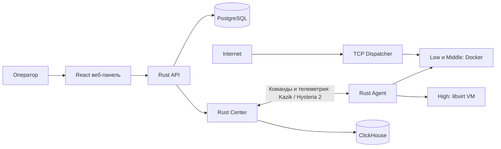

[](https://www.rust-lang.org/)
[](https://clickhouse.com/)
[](https://react.dev/)

# MellCore

Платформа HoneyForge для развёртывания и управления сетевыми ловушками на удалённых серверах. Веб-панель управляет серверами, профилями и ловушками; Rust-агент применяет команды на хостах и передаёт телеметрию в Центр.

## Возможности

- Управление пользователями, ролями, серверами, профилями и ловушками через веб-панель и API.
- Подключение серверов и доставка команд через `hf-center` и `hf-agent`; транспорт между агентом и Центром работает через Hysteria 2 и протокол Kazik.
- Low SSH-ловушка Kozyavka, Middle SSH-ловушка Pritvoryashka с виртуальной оболочкой и High-ловушки на отдельных Linux- и Windows-VM.
- Общий TCP SSH-диспетчер для распределения соединений между совместимыми ловушками.
- Сохранение телеметрии и событий безопасности: PostgreSQL для данных управления и ClickHouse для аналитики.

## Архитектура



Веб-панель обращается только к API MellCore. Центр управляет агентами и принимает их телеметрию; PostgreSQL хранит данные управления, ClickHouse используется для аналитики событий.

## Локальный CLI

Для локального запуска ловушек предназначен отдельный Rust CLI-пакет `hf-cli`, который устанавливает команду `hf`. Он не зависит от `hf-agent`, `hf-center`, `hf-services` и `kazik-protocol`: Центр, регистрация, сетевые протоколы управления, телеметрия и веб-панель не нужны.

Установка из исходного репозитория:

```sh
cargo install --path crates/hf-cli --locked
```

После публикации пакета на crates.io его можно будет установить командой `cargo install hf-cli`.

```sh
sudo hf deploy low --port 2222
sudo hf deploy medium --port 2223
sudo hf deploy high --os ubuntu --port 2224
sudo hf deploy high --os windows --port 3389
sudo hf deploy high --os debian --iso /путь/к/debian.iso --port 2225

sudo hf list
sudo hf stop high-1
sudo hf remove high-1
```

Low и Middle используют уже загруженные образы `honeyforge-low:local` и `honeyforge-pritvoryashka:local`. Их можно переопределить переменными `HF_KOZYAVKA_IMAGE` и `HF_PRITVORYASHKA_IMAGE`. `--shared` запускает отдельный локальный `hf-local-dispatcher` для общего SSH-порта; `--weight` задаёт долю новой ловушки. Для Low доступны четыре режима авторизации, для Middle — выбор ОС, SSH-доступа, сценариев уязвимостей и приманок. В локальном режиме Docker не сохраняет stdout/stderr контейнеров, а события Middle отбрасываются через `/dev/null`.

High проверяет `/dev/kvm`, libvirt/QEMU и зависимости выбранного образа. На Debian/Ubuntu CLI сам устанавливает недостающие пакеты и запускает libvirt до создания VM; для установки нужны права root и доступ к репозиториям пакетов. Можно выбрать готовый образ Ubuntu, Debian, Arch или Windows через `--os` либо установить ОС из своего локального ISO через `--os` и `--iso`. Для готового QCOW2 в другом каталоге есть `--image`. CLI настраивает гостевую Linux VM, подключает её к изолированной сети libvirt с ограниченным исходящим трафиком и публикует SSH; Windows публикует RDP. Состояние CLI хранится в `/var/lib/honeyforge/local/traps.json`; каталог можно изменить через `HF_LOCAL_STATE_DIR`. Подробные параметры — в [документации CLI](crates/hf-cli/README.md).

## Компоненты

| Путь | Назначение |
| --- | --- |
| `frontend/` | Панель React и Vite |
| `backend/` | Rust API на Axum, авторизация, управление ресурсами и PostgreSQL |
| `crates/hf-center/` | Центр регистрации агентов, команд и телеметрии |
| `crates/hf-agent/` | Агент, устанавливаемый на управляемые серверы |
| `crates/hf-cli/` | Независимый локальный CLI `hf` для Low/Middle Docker и High QEMU/KVM ловушек |
| `crates/hf-dispatcher/` | TCP-диспетчер для общих портов SSH-ловушек |
| `crates/hf-core/`, `crates/hf-services/`, `crates/kazik-protocol/` | Общие модели, сервисы и протокол обмена |
| `honeypots/kozyavka/` | Low SSH-ловушка |
| `honeypots/pritvoryashka/` | Middle SSH-ловушка |
| `honeypots/high-*/` | Рецепты и сценарии развёртывания High-ловушек |
| `deploy/` | Скрипты сборки, установки и конфигурации |

## Локальная разработка

Для сборки нужны Rust 1.95+, Node.js/npm; для локальных PostgreSQL и ClickHouse — Docker с Compose plugin.

Сборка Rust workspace:

```sh
cargo build --locked --workspace
```

Backend — отдельный Cargo-пакет. Настрой переменные окружения по [руководству backend](backend/README.md), затем запусти миграции и API:

```sh
cd backend
cargo run --locked -- migrate
cargo run --locked -- serve
```

Для панели открой второй терминал:

```sh
cd frontend
npm ci
npm run dev
```

Vite по умолчанию проксирует `/api` и `/health` на локальный backend. Сборка статических файлов:

```sh
npm run build
```

Инструкции по настройке PostgreSQL, секретов и локального запуска описаны в [backend/README.md](backend/README.md). Настройка панели и production reverse proxy — в [frontend/README.md](frontend/README.md).

## Сборка и установка на VPS

Полная сборка создаёт host-бинарники, Docker-образы ловушек, архив frontend, High-рецепты и файл контрольных сумм:

```sh
bash deploy/vps/build-all-artifacts.sh /root/mellcore-upload-$(date +%Y%m%d-%H%M%S)
```

Установка готового набора артефактов на подготовленный VPS:

```sh
bash deploy/vps/install.sh /root/mellcore-upload-ГГГГММДД-ЧЧММСС
```

Эти скрипты рассчитаны на root и подготовленную Ubuntu 24.04. Они управляют системными службами и Docker-образами. Перед установкой и обновлением прочитай [руководство VPS](deploy/vps/README.md): там описаны состав артефактов, резервные копии, обновление отдельных компонентов и диагностика.

## Безопасность

- Не добавляй пароли, токены, приватные SSH-ключи и рабочие `.env` в Git.
- Переменные `VITE_*` встраиваются в frontend bundle: в них допустимы только публичные настройки.
- Frontend общается с management API; он не содержит токен управления Центром или SSH-данные.
- Для production используй HTTPS и храни секреты в конфигурации сервера с ограниченными правами.

## Лицензия

Workspace-пакеты Rust используют лицензию MIT или Apache-2.0. Отдельные компоненты и артефакты могут иметь свои условия; смотри соответствующие файлы и README в каталогах.
